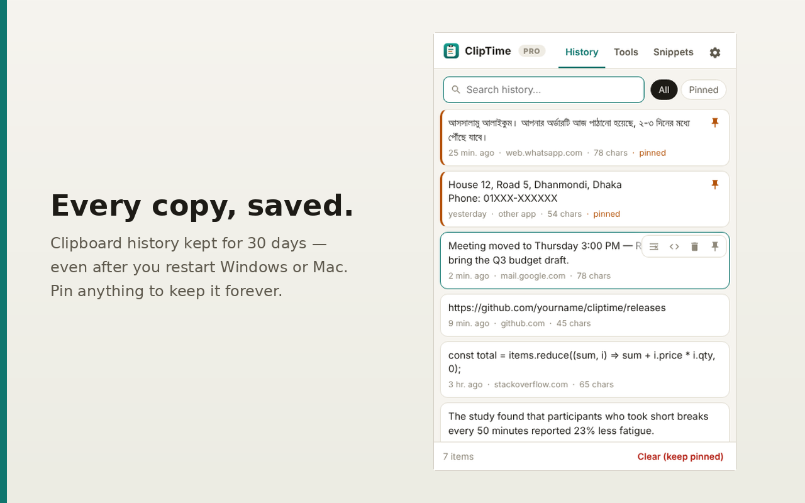

# ClipTime – Clipboard History & Text Tools

Chrome-এ যা কপি করবেন সব সেভ থাকবে — কম্পিউটার (Windows বা Mac) বন্ধ করে আবার চালু করলেও ৩০ দিন পর্যন্ত। সাথে এক ক্লিকে ফাঁকা লাইন সরানো, কেস কনভার্টার, রিইউজেবল স্নিপেট, আর লাইসেন্স কী দিয়ে চালু হওয়া **ClipTime Pro**।



## ফিচার

| | Free | Pro |
|---|---|---|
| 📋 ক্লিপবোর্ড হিস্ট্রি (Ctrl+C, রাইট-ক্লিক কপি, সাইটের "Copy" বাটন, অন্য অ্যাপ) | ২০০টি | ১০,০০০টি |
| 💾 সংরক্ষণ (রিস্টার্টেও থাকে) | ৩০ দিন | ৬০ / ৯০ / ৩৬৫ দিন / সবসময় |
| 🧹 এক ক্লিকে ফাঁকা লাইন সরানো, বাড়তি স্পেস, এক লাইনে জোড়া | ✓ | ✓ |
| 🔠 UPPER / lower / Title / Sentence case | ✓ | ✓ |
| 🔠 camelCase, snake_case, kebab, সাজানো, নম্বর, ডুপ্লিকেট, ১২৩↔123, HTML সরানো | — | ✓ |
| ✍️ স্নিপেট (`;sig` লিখলেই বসে যায়) | ৫টি | আনলিমিটেড |
| 📌 পিন | ৫টি | আনলিমিটেড |
| 💽 ব্যাকআপ / রিস্টোর | — | ✓ |
| 🔒 পাসওয়ার্ড ফিল্ড বাদ, নির্দিষ্ট সাইট বাদ, বাংলা/ইংরেজি UI, `Alt+Shift+V` | ✓ | ✓ |

কোনটা Free আর কোনটা Pro — বদলাতে চাইলে শুধু `extension/lib/plan.js` এডিট করুন।

---

## পুরো সিস্টেম এক নজরে

```
আপনি কোড বদলান ──push──► GitHub ──Actions──► টেস্ট ► zip ► GitHub Release
                                                         │
                                                         ▼
                                    Chrome Web Store API (আপলোড + পাবলিশ)
                                                         │  Google রিভিউ (সাধারণত ১–৩ দিন)
                                                         ▼
                                    সব ইউজারের Chrome নিজে থেকে আপডেট নেয়

🇧🇩 ক্রেতা bKash/Nagad-এ টাকা পাঠায় ──► আপনি জেনারেটরে কী বানান ──► ক্রেতা কী পেস্ট করে ──► Pro চালু
🌍 বিদেশি ক্রেতা কার্ড/PayPal দেয় ──► Lemon Squeezy নিজেই কী ইমেইল করে ──► ক্রেতা পেস্ট করে ──► Pro চালু
                                     └─ টাকা মাসে দুবার আপনার বাংলাদেশি ব্যাংক অ্যাকাউন্টে
```

> **কেন GitHub থেকে সরাসরি আপডেট নয়?** Windows ও Mac-এ Chrome শুধু Chrome Web Store থেকে ইনস্টল করা এক্সটেনশনই চালাতে দেয়। তাই GitHub আপনার "কারখানা" — কোড রাখে, zip বানায়, আর Web Store-এ পাঠিয়ে দেয়; ইউজারদের কাছে আপডেট যায় Web Store দিয়ে।

---

## ১. নিজের কম্পিউটারে টেস্ট করুন

1. `chrome://extensions` → ডান কোণায় **Developer mode** চালু।
2. **Load unpacked** → ভেতরের `extension` ফোল্ডারটা বাছুন।
3. 🧩 আইকনে ক্লিক করে ClipTime **পিন** করুন, তারপর যেকোনো সাইটে কিছু কপি করে দেখুন।

কোড বদলালে `chrome://extensions`-এ ClipTime-এর ↻ বাটন চাপুন।

## ২. প্রিমিয়াম (লাইসেন্স) সেটআপ — পাবলিশের আগে একবার

1. `tools/license-generator.html` ফাইলটা ডাবল-ক্লিক করে Chrome-এ খুলুন।
2. **"নতুন কী-জোড়া তৈরি করুন"** চাপুন →
   - `cliptime-PRIVATE-key.json` ডাউনলোড হবে — **এটা গোপন**। Google Drive/পেনড্রাইভে ব্যাকআপ রাখুন, **কখনো GitHub-এ দেবেন না।** (`.gitignore` আর GitHub Actions দুটোই ভুলবশত আপলোড আটকানোর চেষ্টা করে, তবু সাবধান থাকুন — ব্রাউজারে ড্র্যাগ-ড্রপ আপলোডে `.gitignore` কাজ করে না।)
   - পেজে একটা **পাবলিক কী** দেখাবে।
3. `extension/lib/config.js` খুলে বসান:
   ```js
   LICENSE_PUBLIC_KEY: {"kty":"EC","crv":"P-256","x":"…","y":"…"},
   BUY_URL: 'https://niruvai.github.io/cliptime/',
   REVOKED_URL: 'https://raw.githubusercontent.com/niruvai/cliptime/main/docs/revoked.json',
   PRICE_TEXT_BD: '৳299',
   PRICE_TEXT_INTL: '$4.99',
   ```
4. `docs/index.html` (কেনার পেজ) খুলে নিচের `SHOP = {…}` অংশে নিজের দাম, bKash/Nagad নম্বর, WhatsApp, ইমেইল বসান। রিফান্ডের লাইনটাও নিজের নিয়ম অনুযায়ী বদলে নিন।
5. GitHub-এ পুশ করার পর রিপো → **Settings → Pages** → Source: *Deploy from a branch* → Branch: `main`, ফোল্ডার: `/docs` → Save। কয়েক মিনিটে কেনার পেজ চালু: `https://niruvai.github.io/cliptime/`

### লাইসেন্স বিক্রি করবেন যেভাবে

1. ক্রেতা কেনার পেজ দেখে bKash/Nagad-এ টাকা পাঠিয়ে TrxID + ইমেইল পাঠাবে।
2. আপনি bKash অ্যাপে TrxID মিলিয়ে নিন।
3. `tools/license-generator.html` খুলুন → প্রাইভেট কী লোড → ক্রেতার ইমেইল, মেয়াদ (আজীবন / ১ মাস / ১ বছর…) → **লাইসেন্স কী তৈরি করুন**।
4. তৈরি মেসেজটা কপি করে WhatsApp/ইমেইলে পাঠান। ক্রেতা ClipTime → ⚙ → কী পেস্ট → **চালু করুন**।

জেনারেটরে বিক্রির খাতা থাকে (CSV ডাউনলোড করা যায়)। কাউকে রিফান্ড দিলে বা কী শেয়ার হতে দেখলে **বাতিল** চাপুন, তারপর দেখানো লেখাটা `docs/revoked.json`-এ বসিয়ে কমিট করুন — ২৪ ঘণ্টার মধ্যে ঐ কী বন্ধ হবে।

টার্মিনাল পছন্দ করলে:
```bash
node tools/license-cli.mjs keygen --out ~/cliptime-PRIVATE-key.json
node tools/license-cli.mjs issue --key ~/cliptime-PRIVATE-key.json --email buyer@gmail.com --days 365
```

### জেনে রাখুন

- লাইসেন্স কী ইন্টারনেট ছাড়াই যাচাই হয় (ডিজিটাল সিগনেচার)। আপনার প্রাইভেট কী ছাড়া কেউ নকল কী বানাতে পারবে না।
- একই কী একাধিক কম্পিউটারে চালানো আটকানো যায় না — তাই কী-তে ক্রেতার ইমেইল লেখা থাকে আর সেটিংসে দেখায়, যাতে শেয়ার করতে মানুষ দ্বিধা করে। শেয়ার ধরা পড়লে বাতিল করুন।
- কোড পাবলিক রিপোতে থাকলে প্রোগ্রামার কেউ নিজের কপিতে কোড বদলে Pro খুলে নিতে পারে — এটা সব ওপেন-সোর্স এক্সটেনশনেরই সীমা। সাধারণ ইউজাররা Web Store থেকেই ইনস্টল করেন, তাদের জন্য এটা কার্যকর। চাইলে রিপো **Private** রাখতে পারেন — workflow ঠিকই চলবে, তবে তখন GitHub Pages ও `REVOKED_URL`-এর জন্য অন্য জায়গা লাগবে (যেমন আলাদা একটা পাবলিক রিপো শুধু `docs/`-এর জন্য)।
- `LICENSE` ফাইলটা MIT — এতে অন্যরা আপনার কোড নিয়ে নিজের নামে চালাতে পারে। বিক্রি করলে চাইলে এটা "All rights reserved" ধরনের লাইসেন্সে বদলে নিন।

## ২খ. বিদেশি পেমেন্ট — Lemon Squeezy (কার্ড, PayPal, Apple Pay, Google Pay)

**কেন Lemon Squeezy:** এটা "Merchant of Record" — বিদেশি ক্রেতার কাছে আপনার হয়ে বিক্রি করে, সব দেশের VAT/ট্যাক্স নিজেই সামলায়, ক্রেতাকে নিজে থেকে লাইসেন্স কী ইমেইল করে, আর **বাংলাদেশে ব্যাংক পেআউট সাপোর্ট করে**। আপনার কোনো কোম্পানি বা ট্রেড লাইসেন্স লাগে না। ফি প্রতি বিক্রিতে আনুমানিক ৫% + ৫০¢ (সঠিক হার ওদের Fees পেজে দেখে নিন)।

**সেটআপ:**
1. [lemonsqueezy.com](https://www.lemonsqueezy.com/)-এ অ্যাকাউন্ট খুলে একটা Store বানান।
2. **Settings → Payouts:** বাংলাদেশি ব্যাংক অ্যাকাউন্ট যোগ করুন ও পরিচয় যাচাই (NID/পাসপোর্ট) সম্পন্ন করুন। আসল বিক্রি শুরুর আগে Lemon Squeezy আপনার স্টোর রিভিউ করে অনুমোদন দেয় — সাথে কেনার পেজের লিংক আর প্রাইভেসি পলিসি দিন।
3. **Products → New product:** নাম `ClipTime Pro`, দাম `$4.99` (single payment)।
   - **Generate license keys** চালু করুন।
   - **Activation limit:** `3` (একজন ক্রেতা ৩টা কম্পিউটারে চালাতে পারবে)।
   - **License length:** Unlimited (আজীবন) — অথবা চাইলে ১ বছর।
4. Store ID (Settings → Stores, স্টোরের নামের পাশের `#` সংখ্যা) আর Product ID (প্রোডাক্ট পেজের URL বা API-তে) নিয়ে `extension/lib/config.js`-এ বসান:
   ```js
   LEMON: {
     STORE_ID: 12345,
     PRODUCT_IDS: [67890],
     ...
   ```
5. প্রোডাক্টের **Share** থেকে checkout লিংক কপি করে `docs/index.html`-এ `lemonCheckoutUrl:`-এ বসান। `devices: 3` যেন activation limit-এর সাথে মেলে।
6. টেস্ট: Lemon Squeezy-র **Test mode** চালু করে টেস্ট কার্ডে কিনুন → ইমেইলে আসা কী ClipTime-এ পেস্ট করে দেখুন।

**এরপর সব অটোমেটিক:**
- ক্রেতা পেমেন্ট করলেই কী ইমেইলে চলে যায় (আপনাকে কিছু করতে হয় না)।
- ClipTime কী অনলাইনে চালু করে, প্রতি ৩ দিনে একবার যাচাই করে। ইন্টারনেট না থাকলে ২১ দিন পর্যন্ত Pro চলতে থাকে।
- ৩টার বেশি কম্পিউটারে চালাতে চাইলে আটকে যায়। ক্রেতা পুরনো কম্পিউটারে ⚙ → "কী সরান" চাপলে স্লট খালি হয়।
- রিফান্ড দিলে বা Lemon Squeezy ড্যাশবোর্ডে কী Disable করলে ৩ দিনের মধ্যে Pro বন্ধ হয়ে যায়।
- অন্য কারো Lemon Squeezy স্টোরের কী এখানে কাজ করবে না (Store ID মিলিয়ে দেখা হয়)।

> **বিকল্প:** Gumroad-ও এখন বাংলাদেশে BDT-তে ব্যাংক পেআউট দেয় (ফি বেশি, ~১০% + ৫০¢) আর Paddle বাংলাদেশি বিক্রেতা নেয়। এক্সটেনশন এখন Lemon Squeezy-র কী চেনে; অন্যটা চাইলে বলবেন, যোগ করে দেব।

## ৩. GitHub-এ আপলোড

```bash
cd cliptime
git init
git add .
git status          # নিশ্চিত হোন PRIVATE ফাইল তালিকায় নেই
git commit -m "ClipTime v1.2.0"
git branch -M main
git remote add origin https://github.com/niruvai/cliptime.git
git push -u origin main
```
(ব্রাউজারে আপলোড করলে `.github` লুকানো ফোল্ডারটাও দিতে ভুলবেন না।)

## ৪. প্রথমবার Web Store-এ পাবলিশ (হাতে, একবারই)

1. [Developer Dashboard](https://chrome.google.com/webstore/devconsole) → শর্তে রাজি → এককালীন রেজিস্ট্রেশন ফি। Google অ্যাকাউন্টে **2-Step Verification** চালু থাকতে হবে।
2. GitHub রিপো → **Releases** থেকে `cliptime-v1.2.0.zip` নামান (পুশের কয়েক মিনিট পর Actions নিজেই বানিয়ে রাখে)।
3. **New item** → zip আপলোড।
4. **Store listing** ও **Privacy** ট্যাব `store/LISTING.md` থেকে পূরণ করুন। "contains in-app purchases" অবশ্যই চিহ্নিত করুন।
5. Submit for review।
6. ড্যাশবোর্ডের ঠিকানা থেকে **Extension ID** (৩২ অক্ষরের) আর **Publisher → Settings** থেকে **Publisher ID** লিখে রাখুন — পরের ধাপে লাগবে।

## ৫. অটো-আপডেট চালু করুন (একবারের সেটআপ)

এরপর থেকে প্রতিটা নতুন ভার্সন GitHub থেকে নিজে নিজে Web Store-এ যাবে।

**ক) Google API চাবি বানান**
1. [Google Cloud Console](https://console.cloud.google.com/) → নতুন প্রজেক্ট → **APIs & Services → Library** → "Chrome Web Store API" → Enable।
2. **OAuth consent screen** → External → অ্যাপের নাম দিন → *Test users*-এ নিজের ইমেইল যোগ করুন।
3. **Credentials → Create credentials → OAuth client ID** → টাইপ *Web application* → Authorized redirect URI: `https://developers.google.com/oauthplayground` → Create। **Client ID** ও **Client secret** কপি করুন।
4. [OAuth Playground](https://developers.google.com/oauthplayground) → ডানে ⚙ → *Use your own OAuth credentials* টিক → Client ID/secret বসান → বামে scope লিখুন `https://www.googleapis.com/auth/chromewebstore` → **Authorize APIs** → নিজের অ্যাকাউন্ট দিয়ে অনুমতি → **Exchange authorization code for tokens** → **Refresh token** কপি করুন।
   > OAuth consent screen "Testing" মোডে থাকলে refresh token ৭ দিনে মেয়াদ হারায়। তাই আগে consent screen-এ **Publish app** চেপে "In production" করুন, তারপর এই ধাপে token নিন। অনুমতির সময় "Google hasn't verified this app" এলে **Advanced → Go to … (unsafe)** চাপুন — নিজের অ্যাপ বলে এটা নিরাপদ।

**খ) GitHub-এ গোপন তথ্য রাখুন** — রিপো → **Settings → Secrets and variables → Actions → New repository secret**:

| নাম | মান |
|---|---|
| `CWS_CLIENT_ID` | Client ID |
| `CWS_CLIENT_SECRET` | Client secret |
| `CWS_REFRESH_TOKEN` | Refresh token |
| `CWS_PUBLISHER_ID` | Publisher ID |
| `CWS_EXTENSION_ID` | Extension ID |

## ৬. নতুন আপডেট দেওয়া (প্রতিবার)

**উপায় ক — এক ক্লিকে:** কোড পুশ করুন → GitHub → **Actions → Test & Release → Run workflow** → `patch` (ছোট ঠিকঠাক) / `minor` (নতুন ফিচার) → Run।

**উপায় খ — ভার্সন বাড়িয়ে পুশ:** `extension/manifest.json`-এ `"version"` বাড়ান (যেমন `1.1.0` → `1.1.1`) → পুশ।

এরপর নিজে নিজে হবে: টেস্ট → zip → GitHub Release (`v1.1.1`) → Web Store-এ আপলোড ও রিভিউতে জমা। রিভিউ পাস হলে কয়েক ঘণ্টার মধ্যে সব ইউজারের Chrome নতুন ভার্সন নিয়ে নেয়; তাদের হিস্ট্রি, স্নিপেট ও লাইসেন্স থেকে যায়। ভার্সন না বাড়িয়ে পুশ করলে শুধু টেস্ট চলে, কিছু পাবলিশ হয় না।

Actions ট্যাবে প্রতিটা ধাপ দেখা যায়; লাল ✗ হলে ক্লিক করে কারণ পড়ুন।

---

## ব্যবহার

- কপি করুন → হিস্ট্রিতে যায়। আইটেমে ক্লিক = আবার কপি, ডাবল-ক্লিক = পুরো লেখা।
- আইটেমে মাউস রাখলে: ফাঁকা লাইন ছাড়া কপি · টুলসে খুলুন · মুছুন · পিন।
- রাইট-ক্লিক: সিলেক্ট করা লেখা → ফাঁকা লাইন ছাড়া / UPPERCASE কপি, স্নিপেট হিসেবে রাখা; টেক্সট বক্সে → স্নিপেট বা সাম্প্রতিক কপি বসানো।
- স্নিপেটে `{date}`, `{time}` লিখলে আজকের তারিখ/সময় বসে।

## সীমাবদ্ধতা

- `chrome://` পেজ, Chrome Web Store ও PDF ভিউয়ারে এক্সটেনশন চলে না — সেখানকার কপি পপআপ খোলার সময় ক্লিপবোর্ড থেকে সেভ হয়।
- শুধু টেক্সট সেভ হয়, ছবি নয়। ডেটা ঐ কম্পিউটারের Chrome-এই থাকে।
- Pro-র মেয়াদ শেষ হলে Free-এর সীমা ফিরে আসে — ২০০-র বেশি বা ৩০ দিনের পুরনো (পিন ছাড়া) আইটেম মুছে যায়।

## ফোল্ডার কাঠামো

```
cliptime/
├── extension/                ← Chrome-এ যায়
│   ├── manifest.json
│   ├── background.js         ← হিস্ট্রি, মেয়াদ শেষে মোছা, রাইট-ক্লিক মেনু, লাইসেন্স যাচাই
│   ├── content.js, inject-main.js, offscreen.*, popup.*
│   ├── lib/config.js         ← ★ পাবলিক কী, কেনার লিংক, দাম
│   ├── lib/plan.js           ← ★ Free বনাম Pro-র সীমা
│   ├── lib/license.js        ← bKash/Nagad-এর কী (CT1-…) যাচাই
│   ├── lib/lemon.js          ← বিদেশি কী (Lemon Squeezy) চালু/যাচাই
│   └── lib/text-tools.js, _locales/, icons/
├── tools/
│   ├── license-generator.html  ← লাইসেন্স কী বানানোর পেজ (শুধু আপনার জন্য)
│   └── license-cli.mjs
├── docs/                     ← GitHub Pages: ইংরেজি+বাংলা কেনার পেজ + revoked.json
├── tests/                    ← `node --test tests/*.test.mjs`
├── store/                    ← Web Store-এর লেখা ও ছবি
├── .github/workflows/release.yml  ← টেস্ট → zip → Release → Web Store
├── PRIVACY.md
└── LICENSE (MIT)
```
